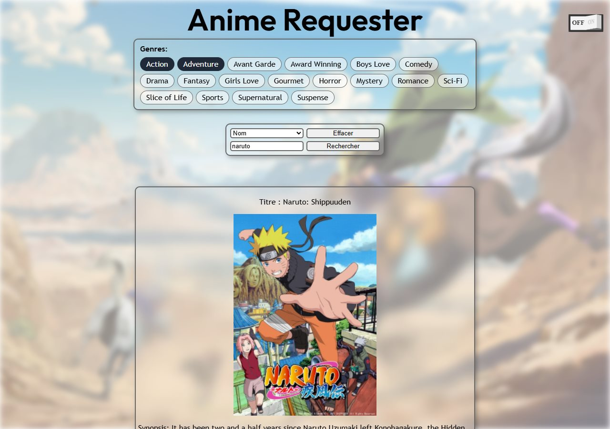
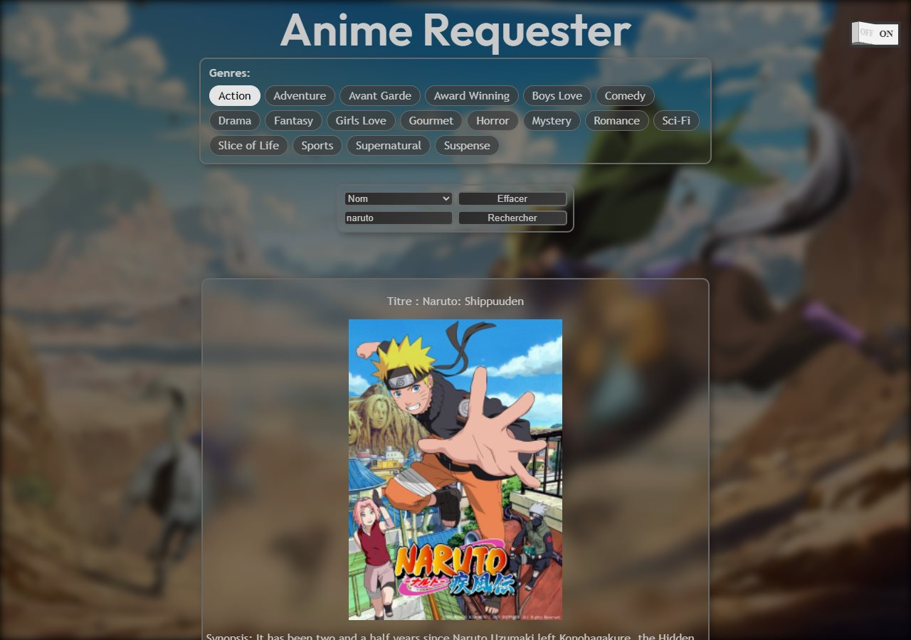

# Anime Requester

Un outil de recherche d'animes en HTML, CSS et JavaScript sans framework, qui interroge l'API Anime DB. Projet d'équipe de BUT Informatique ; ce dépôt est mon fork personnel.

Thème sombre

## Fonctionnalités

- Recherche d'un anime par nom, par identifiant ou par classement.
- Résultats en cartes : titre, image, synopsis, genres, classement et nombre d'épisodes.
- Filtrage par genres : cocher une étiquette filtre aussitôt les résultats affichés.
- Thème clair ou sombre, mise en page adaptée au téléphone.

## Lancer en local

Aucune installation : cloner le dépôt et ouvrir `index.html` dans un navigateur.

L'application a besoin d'une clé gratuite pour l'API Anime DB :

1. Créer un compte sur [RapidAPI](https://rapidapi.com/auth/sign-up).
2. Chercher l'API **Anime DB** et s'abonner au plan gratuit (Basic).
3. Copier la clé affichée dans le champ **X-RapidAPI-Key** de l'onglet Endpoints.

L'application demande la clé à l'ouverture. Elle reste dans le `sessionStorage` du navigateur, n'est envoyée qu'à RapidAPI et disparaît à la fermeture de l'onglet.

## Équipe et ma contribution

Projet réalisé à trois en BUT Informatique, avec Mohamed et Milo.

Je me suis occupé de la partie API :

- construction des URL de requête selon le filtre choisi ;
- recherche par identifiant, par classement et par nom ;
- filtrage des résultats par genre ;
- saisie de la clé API par l'utilisateur et stockage en `sessionStorage`.
